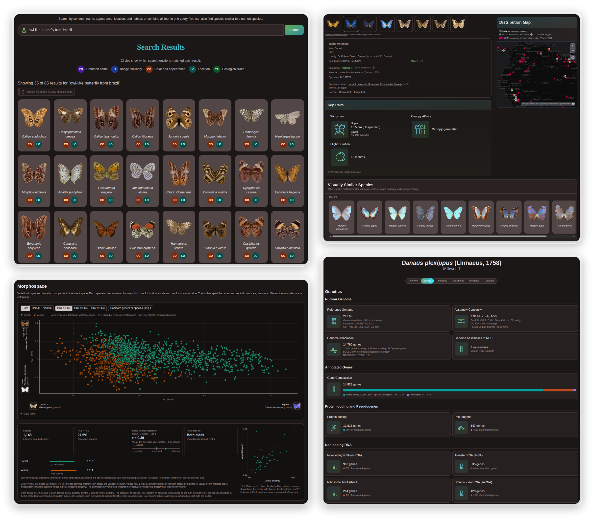

# BioCosmos — Biodiversity Image Platform

An image-based biodiversity platform for butterfly research and education, combining curated museum and occurrence records, machine learning embeddings for wing color-pattern analysis, and integrated data on taxonomy, morphology, geographic distribution, genetics, and literature.

## Features

- **Multi-modal search**: Search by taxonomic name, natural-language descriptions (CLIP and LLM-guided agentic search), or uploaded specimen images.
- **Dorso-ventral morphospaces**: Explore species, genus, and family wing-pattern variation and morphological disparity in interactive PCA morphospaces built from UNICOM embeddings.
- **Taxonomic navigation**: Browse from order to species across a Catalogue of Life classification tree with representative specimen images and coverage statistics.
- **Species and higher-taxon profiles**: Inspect specimen galleries (dorsal/ventral views and sex), validated occurrence maps, visually similar species, LepTraits life-history traits, NCBI genome/sequence summaries, and CrossRef literature.
- **Responsive interface**: Desktop and mobile layouts with light and dark themes.

## Architecture

### Frontend Stack (`src/`)

- **Next.js 16 (App Router) & React 19**: Server and client components with route handlers that proxy backend API requests.
- **TypeScript**: Strict type-safe frontend development.
- **Tailwind CSS 4**: Utility-first styling with light and dark themes.
- **MapLibre GL JS**: Interactive vector maps for geographic distributions, using basemaps from OpenFreeMap.

### Backend Stack (`backend/`)

- **FastAPI (Python 3.12+)**: Asynchronous REST API for search, taxonomy, morphology, and external integrations.
- **DuckDB**: Analytical SQL database storing metadata, harmonized Catalogue of Life taxonomy, validated GADM geography, institutions, traits, precomputed morphospaces, and species similarity.
- **LanceDB**: Vector database storing 768-D UNICOM and 512-D CLIP image embeddings for fast nearest-neighbor search.
- **PyTorch, Transformers & UNICOM**: Vision and vision-language models for fine-grained biological similarity and semantic text-to-image retrieval.

### Workspace Packages (`packages/`) and Analyses (`analyses/`)

Seven Python packages in `packages/` share the root `uv` workspace with the backend:

- **[`harmonize-core`](packages/harmonize-core/README.md)**: Shared DuckDB catalog access, TOML configuration, country/place normalization, and artifact reporting.
- **[`colharmonize`](packages/colharmonize/README.md)**: Matches recorded scientific names against a Catalogue of Life release (also run by the backend at startup).
- **[`geoharmonize`](packages/geoharmonize/README.md)**: Validates occurrence coordinates against GADM administrative boundaries.
- **[`instharmonize`](packages/instharmonize/README.md)**: Resolves museum and collection codes to institution names and websites via GBIF GRSciColl.
- **[`morphospace`](packages/morphospace/README.md)**: Precomputes dorso-ventral PCA morphospaces, morphological disparity, and Mantel correlations from UNICOM embeddings.
- **[`similarity`](packages/similarity/README.md)**: Precomputes the visually similar species displayed on species pages.
- **[`plannerbench`](packages/plannerbench/README.md)**: Benchmarks language models on the production agent-search planner prompt.

Offline runs write reproducible artifacts and SHA-256 manifests under [`reports/`](reports/README.md). Publication figures, dataset exports, and vector-index benchmarks live in [`analyses/`](analyses/README.md).

## Contributing

See [CONTRIBUTING.md](CONTRIBUTING.md) for local setup, data ingestion, testing, caching rules, deployment, API routes, and the pull request workflow.

## License

This project is licensed under the MIT License — see the [LICENSE](LICENSE) file for details.

## Acknowledgments

- **OpenAI CLIP** & **UNICOM**: Vision models for semantic and fine-grained biological image similarity
- **LanceDB** & **DuckDB**: Embedded vector and analytical databases
- **FastAPI**, **Next.js** & **MapLibre GL JS** (with basemaps from **OpenFreeMap**)
- **Catalogue of Life**, **GBIF**, **GADM**, **LepTraits**, **NCBI** & **CrossRef**: Taxonomic, geographic, trait, genetic, and bibliographic data sources
- **Butterfly Dataset Contributors**: Museum collections and researchers providing specimen images and occurrence data
- **Mammal Diversity Database**: Design inspiration for species profiles and taxonomic navigation

---

**BioCosmos** — Exploring biodiversity through the lens of AI.
